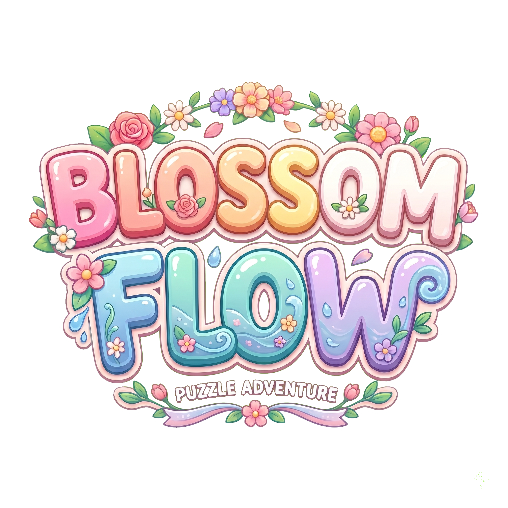

<p align="center">
  
</p>

<h1 align="center">Blossom Flow</h1>

<p align="center">
  A hybrid-casual sort puzzle about pots, flowers and a greenhouse conveyor belt.<br>
  Built with Unity 6 by <b>Hexapawa(Mustafa Çetin)</b>.
</p>

---

## Gameplay

The board is a grid of colored flowers surrounded by a greenhouse conveyor belt. Three columns of pots wait at the bottom of the screen.

1. **Tap a pot.** Only the front pot of each column can be selected. It launches onto the conveyor belt and the next pot in that column moves forward.
2. **Collect.** As the pot travels around the belt it scans the grid and pulls in **accessible** flowers of its own color. Flowers are cleared from the outside in, and hidden flowers can't be reached. Each flower lowers the pot's remaining capacity by one.
3. **Resolve.** A full pot leaves play. A pot that reaches the end of the belt unfilled drops into one of the **waiting slots**. Tap it to send it back onto the belt.
4. **Win or fail.** Clear every flower to win. If an unfinished pot reaches the end of the belt while every waiting slot is taken, the level fails.

Pot capacities always add up exactly to the flowers on the board, color by color, so every level can be solved.

**Special rules and boosters**

- **Linked Pots**: pots linked across adjacent columns can only be launched once every member of the group is at the front. They also enter and leave waiting slots as a group.
- **Shuffle**: reorders the queued pots, with a short animation. Limited uses per level.
- **Extra Waiting Slot**: adds one more usable waiting slot for the current attempt.

**Around the core loop**: a main menu with Shop / Home / Garden tabs, lives and gold, a daily login bonus, a garden you grow with *Magical Seeds*, a first-level tutorial, and a runtime debug overlay.

## Tech Stack

| Area | Technology |
|---|---|
| Engine | Unity **6000.3.6f1**, Universal Render Pipeline (2D) |
| Dependency injection | [Reflex](https://github.com/gustavopsantos/reflex) (vendored in `Assets/Reflex`) |
| Async | [UniTask](https://github.com/Cysharp/UniTask) |
| Tweening | [DOTween](https://dotween.demigiant.com/) |
| Input | Unity Input System (tap-only controls) |
| UI | uGUI + TextMeshPro, safe-area-aware portrait layout |
| Debug tooling | nickeltin Debug Panel (embedded packages under `Packages/`) |
| Platform SDK | CrazyGames SDK (WebGL): rewarded ads, gameplay start/stop, audio mute |
| Targets | WebGL (CrazyGames), Android |

## Architecture

The code follows SOLID principles and is wired together with **Reflex** as the only composition root. Classes get their dependencies through constructor injection (plain C#) or `[Inject]` methods (`MonoBehaviour`). Gameplay code uses no service locators, global singletons or `FindObjectOfType` lookups.

### Layers

```
Domain        Pure C# game rules: no Unity scene dependencies, deterministic, testable
Application   Use cases and services: level catalog, scene loading, audio, analytics, ads, tutorials
Presentation  MonoBehaviour views that render state and forward input
```

The core rules live in Unity-independent domain types:

- `LevelSession`: owns one attempt and its play state (playing, won, failed)
- `FlowerGrid` / `FlowerCell`: the 2D board and its outer-to-inner accessibility rules
- `ConveyorBelt` / `ConveyorPath` / `ConveyorScan`: pots moving along the belt and line-of-sight collection
- `PotModel` / `PotStateMachine`: pot capacity and enforced transitions (`Idle → Launching → Conveying → Collecting → Waiting / Full / Broken`)
- `PotQueueColumn`, `WaitingSlots`: the three launch queues and the waiting area

### Dependency injection scopes

| Installer | Scope | Registers |
|---|---|---|
| `RootInstaller` | Project-wide | EventBus, level catalog and selection, startup and scene loading, audio, analytics, ads, player progress, tutorials, runtime debug overlay |
| `MainMenuInstaller` | `MainMenuScene` | Menu navigation, play controller, garden, daily login bonus |
| `GameInstaller` | `GameScene` | Level session factory, level advancing, Shuffle and Extra Waiting Slot boosters, RNG |

Each scene that needs injection has exactly one `ContainerScope`, which inherits from the root container.

### Event bus

Features talk to each other through a typed, Reflex-owned `EventBus` (`Assets/Scripts/Application/Events`). Following interface segregation, consumers depend on the smallest contract they need:

- `IEventPublisher`: publish only
- `IEventSubscriber`: subscribe only
- `IEventBus`: both, only when actually needed

Event types are small messages kept next to the feature that owns them (`ShuffleBoosterEvents`, `MainMenuEvents`, `RemoteLevelCatalogEvents`, and so on).

### Platform services behind interfaces

Platform-specific code sits behind abstractions, so the game runs with or without a given SDK:

- `IAnalyticsEventService` → `NullAnalyticsEventService` fallback, plus journey and retention reporters
- `IRewardedAdService` → `CrazyGamesRewardedAdService`
- `IGameplayPlatformSessionReporter` → `CrazyGamesGameplaySessionReporter`
- `IExternalAudioMuteProvider` → `CrazyGamesAudioMuteProvider`
- `IFrameRateConfigurator` → `MobileNativeRefreshRateConfigurator`

## Scene Flow

```
LoadingScene  ──►  MainMenuScene  ──►  GameScene
     ▲                                     │
     └──────── SceneTransitionService ◄────┘
```

`LoadingScene` runs startup service initialization and preloads the level catalog. All later scene changes go through `SceneTransitionService` and the shared loading screen.

## Level Pipeline

- **Data**: each level is a `LevelDefinitionAsset` ScriptableObject that stores grid size, flower color per cell, blockers, the three pot queues and the conveyor path. Levels live in `Assets/Levels`.
- **Validation**: malformed or impossible levels are rejected deterministically, for example when pot capacity doesn't match the flowers on the board.
- **Authoring tool**: `LevelPreparationWindow` is a custom editor window for painting flower grids and building pot queues, including text import/export of queues.
- **Procedural generation**: `ProceduralLevelDefinitionGenerator` combines `BalancedRandomFlowerGridGenerator` and `ColorMatchedPotQueueGenerator`. The output is seeded and deterministic, so the same settings always produce the same level.
- **Catalog**: `LevelCatalog` / `RemoteLevelCatalog` hold the level order. The selected level is passed from the menu to the game scene through a root-scoped selection service rather than per-scene data.

## Project Structure

```
Assets/
├── Levels/                 Level definition assets
├── Prefabs/                Gameplay and UI prefabs
├── Reflex/                 Reflex DI framework (vendored)
├── Plugins/                UniTask, DOTween, CrazyGames jslib
├── Scenes/                 LoadingScene, MainMenuScene, GameScene
├── Scripts/
│   ├── Application/        Ads, Analytics, Audio, Debugging, Events, Levels,
│   │                       Performance, Platform, SceneLoading, Tutorial
│   ├── Editor/             LevelPreparationWindow
│   ├── Gameplay/
│   │   ├── Application/    Level advance flow
│   │   ├── Domain/         Board, conveyor, pots, slots, boosters, level data & generation
│   │   └── Presentation/   Views, input, boosters UI, tutorial
│   ├── Installers/         RootInstaller, MainMenuInstaller, GameInstaller
│   ├── MainMenu/           Domain, Presentation, DailyLogin
│   └── Presentation/       Shared sprite views
└── Sprites/                Game artwork
Packages/                   Embedded nickeltin packages + manifest
```

## Getting Started

1. Install **Unity 6000.3.6f1** (or a compatible Unity 6.3 version) with the WebGL and/or Android build modules.
2. Clone the repository and open the folder in Unity Hub.
3. **Import the third-party assets that aren't included.** Their licenses don't allow redistribution, so they're left out of this repository:
   - [2D Game UI Kit by 300Mind](https://assetstore.unity.com/) → `Assets/300Mind/`
   - Casual Game Sounds U6 → `Assets/Casual Game Sounds U6/`
   - Background music track → `Assets/backgroundmusic/`

   Without them the project still compiles, but some UI sprites, sound cues and the music reference will show up as missing.
4. Open `Assets/Scenes/LoadingScene.unity` and press **Play**.

> **Android builds:** the signing keystore isn't part of the repository. Set your own keystore under *Project Settings → Player → Publishing Settings*.

## License

Copyright © 2026 Mustafa Cetin (Hexapawa).

This project is **source-available** under the [PolyForm Strict License 1.0.0](LICENSE.md). It is **not** an OSI-approved open-source license.

**You may**

- read and study the source code
- run the project for noncommercial purposes such as personal study, research, hobby experiments or education

**You may not**

- distribute the source code or any build of the game, modified or not
- publish the game or anything built from it on **any store or platform**, including Google Play, the App Store, Steam, itch.io, CrazyGames or any web portal
- modify the code or create new works, games or projects based on it
- use it for any commercial purpose

The *Blossom Flow* name, logo and game artwork aren't licensed for any use. For any other kind of permission, including a commercial license, contact the author through their GitHub profile.

The full legal terms are in [LICENSE.md](LICENSE.md). If this summary and the license text disagree, the license text applies.

### Third-party components

The license above covers only the author's original code and assets. Third-party components keep their own licenses:

- [Reflex](https://github.com/gustavopsantos/reflex) (`Assets/Reflex`): MIT
- [UniTask](https://github.com/Cysharp/UniTask) (`Assets/Plugins/UniTask`): MIT
- [DOTween](https://dotween.demigiant.com/license.php) (`Assets/Plugins/Demigiant`): DOTween license
- nickeltin packages (`Packages/com.nickeltin.*`): their author's license
- CrazyGames SDK (`Assets/Plugins/crazySDK.jslib`): CrazyGames terms
- Unity packages: Unity Companion License / Unity Terms of Service
